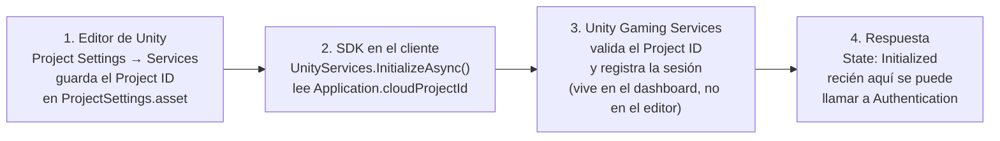

# Lab 01 — Servicios y autenticación (UGS)

> Relacionado: [[Avances del juego]] · [[CloudSave-CloudCode]] · [[Lab08-Combate]] · [[Lab11-Ranking]] · [[PartidaOnline]]

**Guía de Laboratorio #1 — resuelta en una escena aparte**
**Tema:** inicializar UGS, entender dónde se rompe y autenticar (invitado, usuario/contraseña, unificar usuarios)
**Alumno:** Alexander Villena · **Fecha:** 2026-11-07 · **Escena:** `Assets/Scenes/Lab01-Autenticacion.unity`

La regla del laboratorio en una frase: **`InitializeAsync` NO valida el Project ID**. El arranque
siempre dice `Initialized`; el servicio recién contesta cuando se le pide algo (`SignInAnonymouslyAsync`).
Por eso el paso 6 se ve raro si uno se queda mirando el paso 5.

---

## 0. Lo que evalúa la guía y dónde está

| Capacidad pedida | Dónde está | Cómo se demuestra |
|---|---|---|
| **Anotar versiones exactas** (editor + `core` + `authentication`) | `ProjectSettings/ProjectVersion.txt` y `Packages/manifest.json` | El panel de la escena las imprime en el bloque de estado (se leen del ensamblado cargado, no de un texto fijo). |
| **Arrancar los servicios y documentar los dos fallos** | `Assets/Scripts/Online/Auth/ServiciosBootstrap.cs` → `InicializarAsync` | `[DVSC] Servicios listos. Estado: Initialized` y, en el paso 6, la excepción con su `ErrorCode` + las líneas `[Authentication]`. |
| **Handshake real + captura del dashboard** | `LoginAnonimoAsync` (`SignInAnonymouslyAsync`) | Ficha en `Player Management → Players` con **Player ID**, *Sign-in: Enabled* y hora. |
| **Invitado, usuario/contraseña y unificar usuarios** | `ServiciosBootstrap`: `LoginAnonimoAsync`, `SignUp/SignInWithUsernamePasswordAsync`, `AddUsernamePasswordAsync` | El menú del juego: **Jugar como invitado**, **Crear cuenta**, **Ya tengo cuenta** y, dentro de la sesión, **Guardar progreso** (mismo Player ID antes y después). |

---

## 1. Paso 1 — versiones que resuelve el Package Manager

| Dato | Valor en este proyecto | Guía | Estado |
|---|---|---|---|
| Editor | **6000.6.0f1** (`f7f8ed4d1e24`) | 6000.3.18f1 (6.3 LTS) | distinto (misma familia 6.x) |
| `com.unity.services.core` | **1.18.0** | 1.18.0 | **coincide** |
| `com.unity.services.authentication` | **3.7.4** | 3.7.4 | **coincide** |

Que `core` y `authentication` coincidan importa: son los paquetes cuyas firmas usa el kit
(`UnityServices.InitializeAsync`, `AuthenticationService.Instance`, `AddUsernamePasswordAsync`).
El editor no coincide, pero las tres APIs usadas compilan tal cual contra 6000.6.0f1.

> **Ojo con esto:** `Packages/manifest.json` **no** listaba los dos paquetes. Llegaban como dependencia
> transitiva de `cloudcode` / `cloudsave` / `leaderboards`, así que el Package Manager los instalaba
> igual, pero el paso 4 pide verlos escritos en el manifiesto. Ya están fijados.

---

## 2. Paso 3 — vincular el proyecto (Project ID)

Ya estaba vinculado desde los laboratorios anteriores; **no** se creó un proyecto nuevo.

| Dato | Valor |
|---|---|
| Organización | `alexandervillenaezio5557` |
| Proyecto | `Quizzerttack` |
| **Project ID** | `5906c36b-06d8-410b-91be-cf367616022a` |

`ProjectSettings/ProjectSettings.asset` → `cloudProjectId: 5906c36b-06d8-410b-91be-cf367616022a`.
El panel muestra lo que Unity tiene cargado en `Application.cloudProjectId`, así que sirve de
comprobación rápida antes de capturar.

---

## 3. Paso 4 — paquetes en el manifiesto

`Packages/manifest.json` (líneas nuevas):

```json
"com.unity.services.authentication": "3.7.4",
"com.unity.services.core": "1.18.0",
```

Coinciden con lo que hay instalado en `Library/PackageCache` (`com.unity.services.authentication@3.7.4`
y `com.unity.services.core@1.18.0`).

---

## 4. Paso 5 — script de arranque

`Assets/Scripts/Online/Auth/ServiciosBootstrap.cs`:

```csharp
var opciones = new InitializationOptions();
opciones.SetEnvironmentName(entorno);            // "production"

await UnityServices.InitializeAsync(opciones);
// [DVSC] Servicios listos. Estado: Initialized
```

Detalles que no son adorno:

- **`using Unity.Services.Core.Environments;`** es obligatorio: sin ese `using`, `SetEnvironmentName`
  (un método de extensión) no compila.
- `AuthenticationService.Instance` **lanza `ServicesInitializationException` si se toca antes** de
  inicializar. Por eso `ServiciosBootstrap` guarda todo detrás de `Listo` y el bloque de estado no
  accede al singleton hasta que `UnityServices.State == Initialized`.
- Si otro script ya disparó la inicialización, `InicializarAsync` espera (`Initializing`) en vez de
  lanzar una segunda llamada.

---

## 5. Paso 6 — los dos fallos (lo que hay que anotar en el informe)

Los reproduce el panel en **Herramientas del lab** (se abre con **F9** desde cualquier pantalla) → botones **8** y **9**: imprimen el detalle exacto de la excepción.
Pero hay que provocar la condición a mano; no se puede inyectar el Project ID por código
(`InitializationOptions` solo expone `SetEnvironmentName`, el ID sale de `Application.cloudProjectId`).

### 6A — Project ID inválido

1. `Edit → Project Settings → Services`, dejar un Project ID inventado (o desconectar el proyecto).
2. Volver a **Play** y entrar desde el menú (o usar **Herramientas → 8**).

Lo que se ve, y es exactamente lo que hay que explicar:

- El arranque dice **`Servicios listos. Estado: Initialized`** — `InitializeAsync` **no** valida el ID.
- El fallo aparece recién al autenticar, y en el `catch` el mensaje llega **vacío**:
  - consola: `[Authentication]: Request failed: 404, {"detail":"","requestId":"…","status":404,"title":"RESOURCE_NOT_FOUND"}`
  - y en el código: `RequestFailedException` **sin mensaje** (`ErrorCode` es lo único útil).
- **No es un error de red**: el detalle está en las líneas `[Authentication]`, no en la excepción.

### 6B — sin conexión

1. Desconectar WiFi/Ethernet y elegir **Jugar como invitado** (o **Herramientas → 9**, que hace lo mismo con su aviso).

Lo que se ve:

- También cae en el `catch`, con mensaje vacío o inútil.
- La diferencia con 6A está en la consola: aquí la petición **no sale** (no hay `RESOURCE_NOT_FOUND`
  del servicio), es un fallo de transporte.

> Comparar los dos textos de consola es justamente el objetivo del paso: **mismo `catch`, causas distintas**.

---

## 6. Paso 7 — handshake y evidencia en el dashboard

`SignInAnonymouslyAsync` es lo que crea la ficha. La captura válida es **del dashboard**, no del editor:

`Player Management → Players` (entorno de producción) → debe aparecer una fila con:

- **Player ID** (el mismo que imprime el panel en `Player ID`)
- **Sign-in:** `Enabled`
- **Created / Last login** con la hora de la prueba

Recortar la URL del navegador (lleva organización y Project ID), como pide la guía.
Inicializar sin `SignInAnonymouslyAsync` **no** crea nada: el paso 5 solo no prueba el handshake.

---

## 7. Paso 8 — diagrama



Dónde se rompe:

| Fallo | Causa | Qué NO prueba |
|---|---|---|
| **6A** Project ID incorrecto | El SDK arranca y acepta el ID; el servicio lo rechaza en la primera petición (`404 RESOURCE_NOT_FOUND`) | Que la consola esté callada: el paso 5 siempre dice `Initialized` |
| **6B** Sin conexión | La petición nunca sale (fallo de transporte, no un 404 del servicio) | El mensaje del `catch` (llega vacío): la evidencia está en `[Authentication]` |

---

## 8. Lo que había que implementar

La pantalla se armó como el menú de acceso de un juego online, no como un formulario de prueba:

| Pantalla | Qué ofrece | Método del SDK 3.7.4 |
|---|---|---|
| Menú de inicio | **JUGAR COMO INVITADO** | `SignInAnonymouslyAsync()` |
| Menú de inicio | **CREAR CUENTA** | `SignUpWithUsernamePasswordAsync(usuario, clave)` |
| Menú de inicio | **YA TENGO CUENTA** (iniciar sesión) | `SignInWithUsernamePasswordAsync(usuario, clave)` |
| Mi cuenta (lobby) | **GUARDAR PROGRESO** → unificar usuarios | `AddUsernamePasswordAsync(usuario, clave)` |
| Mi cuenta (lobby) | **JUGAR** → carga la escena del juego | `SceneManager.LoadScene(escenaSiguiente)` |
| Mi cuenta (lobby) | **CERRAR SESIÓN** | `SignOut()` |
| Herramientas del lab | estado, registro, pasos 6A / 6B, copiar (**F9**, oculto del menú) | — (solo diagnóstico) |

Detalles de la interfaz:

- Todo el UI se construye por código en `PanelAuthLab01.cs` (uGUI + TextMeshPro); la escena solo
  lleva un GameObject `AuthLab01` con ese componente.
- "GUARDAR PROGRESO" **solo aparece si el jugador es invitado**; si ya tiene usuario/contraseña
  se muestra el aviso contrario. Así el flujo se explica solo.
- Los mensajes de error salen en pantalla y, con el detalle completo, en **Herramientas → registro**
  (y en la consola, donde además aparecen las líneas `[Authentication]`).
- El botón **JUGAR** sale del lab y abre la escena del juego con la sesión ya abierta. La escena destino
  es el campo `escenaSiguiente` del componente (`Main Menu` por defecto); antes de cargar comprueba con
  `Application.CanStreamedLevelBeLoaded` que esté en Build Settings.

### Cómo se demuestra la unificación

`AddUsernamePasswordAsync` **añade** la credencial al jugador que ya está logueado (el invitado),
así que el **Player ID no cambia** y la partida del invitado no se pierde.

Orden de la demo (y de las capturas):

1. **JUGAR COMO INVITADO** → anotar `Player ID` (ej. `ID-A`), identidades `[anonymous]`.
2. **GUARDAR PROGRESO** con usuario/clave → `Player ID` sigue siendo `ID-A`, identidades
   `[anonymous, username]`. La pantalla muestra `Hola, <usuario>`.
3. **CERRAR SESIÓN** y **YA TENGO CUENTA** con ese usuario/clave → vuelve `ID-A`.
4. **CREAR CUENTA** con otro usuario → aparece otro `Player ID` (`ID-B`). Sirve para explicar en el
   informe que registrarse **no** es unificar: es otro jugador.

El código lo verifica solo: imprime `Player ID IDÉNTICO antes y después` o avisa si cambió.

### Límites que impone el SDK (validados en el cliente, con mensaje claro)

- **Usuario**: 3-20 caracteres de `[A-Za-z0-9.-@_]` (sin espacios).
- **Contraseña**: 8-30 caracteres con al menos 1 mayúscula, 1 minúscula, 1 número y 1 símbolo.
  La pantalla de crear pide **repetirla** y compara antes de llamar al servicio.
- `SignUp`/`SignIn` fallan con `ClientInvalidUserState` (10000) si ya hay una sesión abierta:
  por eso el código cierra sesión antes de entrar con usuario/contraseña.
- Para vincular hace falta **estar logueado**: el botón **GUARDAR PROGRESO** no existe sin sesión.

### Problema real encontrado al probar usuario/contraseña

Si el proveedor no está habilitado en el proyecto, el servicio responde:

```
[Authentication]: Request failed: 401, {"detail":"usernamepassword external id provider is not available: PERMISSION_DENIED…"}
```

y el `catch` recibe `AuthenticationException` con `ErrorCode=10002` y **mensaje vacío**: otro caso
real del mismo comportamiento que pide documentar el paso 6. Se resuelve en el dashboard:
**Player Management → Player Authentication → Identity providers → habilitar Username and password**.
(Ojo: el invitado puede funcionar perfectamente con el proveedor anónimo habilitado y este no.)

---

## 9. Archivos

| Archivo | Estado | Qué aporta |
|---|---|---|
| `Assets/Scenes/Lab01-Autenticacion.unity` | **nuevo** | Escena aparte (no toca `campo de batalla` ni el menú): cámara, `EventSystem` con `InputSystemUIInputModule` y el GameObject `AuthLab01`. |
| `Assets/Scripts/Online/Auth/ServiciosBootstrap.cs` | **nuevo** | Arranque (paso 5), handshake (paso 7), invitado / usuario-contraseña / unificar, resumen de estado y detalle de excepciones. |
| `Assets/Scripts/Online/Auth/PanelAuthLab01.cs` | **nuevo** | Menú de acceso tipo juego construido por código (uGUI + TMP): inicio con invitado / crear cuenta / ya tengo cuenta, lobby de sesión, guardar progreso y pantalla de herramientas del lab. |
| `Packages/manifest.json` | modificado | `com.unity.services.authentication: 3.7.4` y `com.unity.services.core: 1.18.0` explícitos (paso 4). |
| `ProjectSettings/EditorBuildSettings.asset` | modificado | La escena queda en Build Settings (al final de la lista, sin desplazar el menú). |

Nada de esto usa `#if UGS_ON` a propósito: los dos paquetes están fijos en el manifiesto, así que la
escena funciona aunque el define no esté puesto.

**Cómo se monta:** abrir `Assets/Scenes/Lab01-Autenticacion.unity` → **Play**. No hay que arrastrar
nada: el panel crea su Canvas, sus botones y sus campos al arrancar (`Start`).

---

## 10. Pendiente (lo que falta para entregar)

- **Capturas**: panel con las tres operaciones (invitado → unificado → login con usuario) y la ficha
  del dashboard del paso 7.
- **Fallo 6A y 6B**: pegar en el informe el texto exacto de consola de cada uno (van con fecha y hora).
- **Hoja con el diagrama** del paso 8 (el bloque Mermaid de arriba es el contenido).
- **PDF de la guía** y **zip** del laboratorio.

Estado del código: **implementado y compilado** contra los ensamblados reales del proyecto
(core 1.18.0, authentication 3.7.4, TMP, Input System) sin errores ni avisos. Lo que falta es la
evidencia de ejecución, que hay que sacar en el editor.
